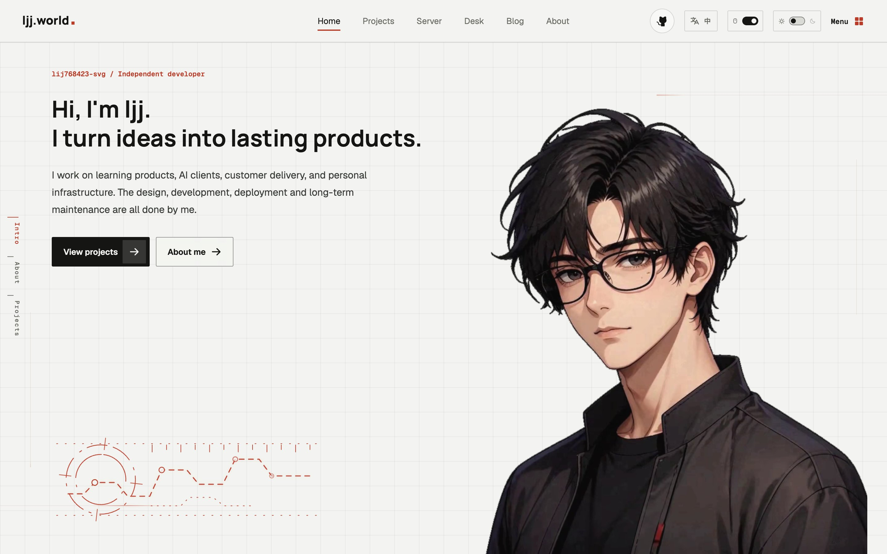

## Hi, I'm Ljj

CS student. I build practical AI tools, self-hosted services and open-source web apps, and run most of them on my own home server.

计算机专业学生，做实用的 AI 工具、自托管服务和开源 Web 应用，大部分跑在自己家里的服务器上。完整作品集在 **[ljj.world](https://ljj.world)**：项目索引、服务器拆解、桌面档案，都是可以点进去的交互场景。

### 自己的项目

| 项目 | 是什么 |
| --- | --- |
| **[meshatlas](https://github.com/lij768423-svg/meshatlas)** | Tailscale tailnet 的实时 HUD 地图：节点位置、直连 / DERP / peer-relay 路径、延迟矩阵、容器与服务。零依赖。 |
| **[行记 · pluggable-city-travel-agent](https://github.com/lij768423-svg/pluggable-city-travel-agent)** | 大模型旅行规划 Agent，Web 端 + MCP 服务。新城市一条命令接入，已接北上广深等十城；LangGraph + OR-Tools 排程。本科毕设。 |
| **[408 刷题库](https://github.com/lij768423-svg/408-quiz)** | 408 考研刷题：2378 道题、错题按间隔重现、AI 讲题、可带走的 Markdown 知识库。在线版 [quiz.hermesjj.com](https://quiz.hermesjj.com/)。 |
| **[ai-quota](https://github.com/lij768423-svg/ai-quota)** | 一页看 Claude、Codex、Grok、Antigravity 的订阅额度。只读本机数据，不登录、不碰凭据。 |
| **[ljj-world](https://github.com/lij768423-svg/ljj-world)** | 上面那个作品集本身：React 19 + Three.js，DNA 螺旋项目索引、可以拆开的服务器。 |

### Grok 生态

| 项目 | 是什么 |
| --- | --- |
| **[grok-register-panel](https://github.com/lij768423-svg/grok-register-panel)**  | Grok 批量注册引擎 + 实时 Web 监控面板：并发、ASN 黑名单、代理池、Token 鉴权。 |
| **[grok2api-egress-enhancements](https://github.com/lij768423-svg/grok2api-egress-enhancements)**  | grok2api 出口质量守护：代理快速恢复、熔断隔离、节点迁移和运维面板。 |
| **[chenyme/grok2api](https://github.com/chenyme/grok2api)** 上游贡献 | [20+ 个 PR 已合并](https://github.com/chenyme/grok2api/pulls?q=is%3Apr+author%3Alij768423-svg+is%3Amerged)：流式质量守护、账号冷却、Grok CLI 兼容等。 |

### 常用技术

Python · TypeScript · Go · React · FastAPI · LangGraph · Playwright · Docker · Tailscale · Cloudflare

---

有问题欢迎在对应仓库开 issue 或 discussion。想看后续新项目，点头像下面的 **Follow**。
